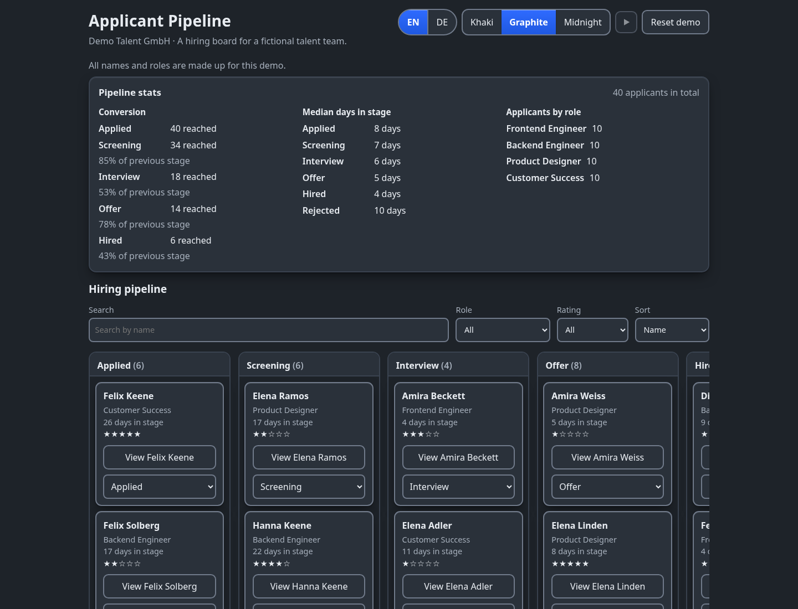
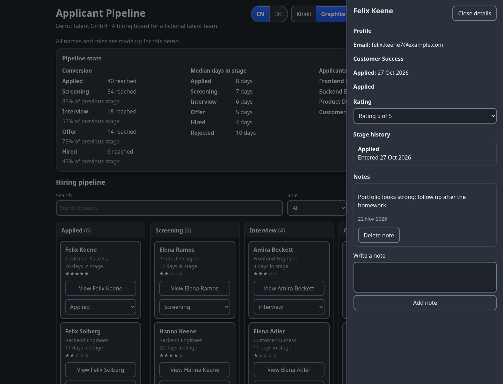

# Applicant Pipeline

**Live: https://ali1129js.github.io/applicant-pipeline/**

A hiring pipeline board for the fictional company **Demo Talent GmbH**. Every applicant, role and note is generated demo data. Any resemblance to real people or organisations is coincidental.





## Features

- Six stages (Applied, Screening, Interview, Offer, Hired, Rejected) as a horizontally scrolling board.
- Cards can be moved by drag and drop or with a labelled stage select, so the board stays usable from the keyboard.
- Rejecting someone asks for a reason. Hired is a terminal stage.
- A detail drawer shows the profile, stage history, notes and rating. Focus stays in the drawer and Escape closes it.
- Search, role and rating filters, and in-column sort. The filter state is kept in the URL so a view can be shared.
- A stats strip shows funnel conversion, median days in each stage and counts by role.
- The board is saved in this browser (`localStorage`, checked with Zod). "Reset demo" asks for confirmation first.
- Three gloss themes (Khaki, Graphite, Midnight; Graphite is the default), a motion toggle that stays off until you turn it on, and English or German.

## Stack

Vite, React 19, TypeScript (`strict`, `noUncheckedIndexedAccess`, `exactOptionalPropertyTypes`), Zod, Vitest and Testing Library. Deployed to GitHub Pages from an Actions workflow.

## Getting started

```bash
npm install
npm run dev
npm test
npm run lint
npm run typecheck
npm run build
npm run guard
```

## Learning notes

See [docs/LEARN.md](docs/LEARN.md) for short explanations of drag-and-drop accessibility, validating data at the edges with Zod, and keeping filters in the URL.

## License

MIT
